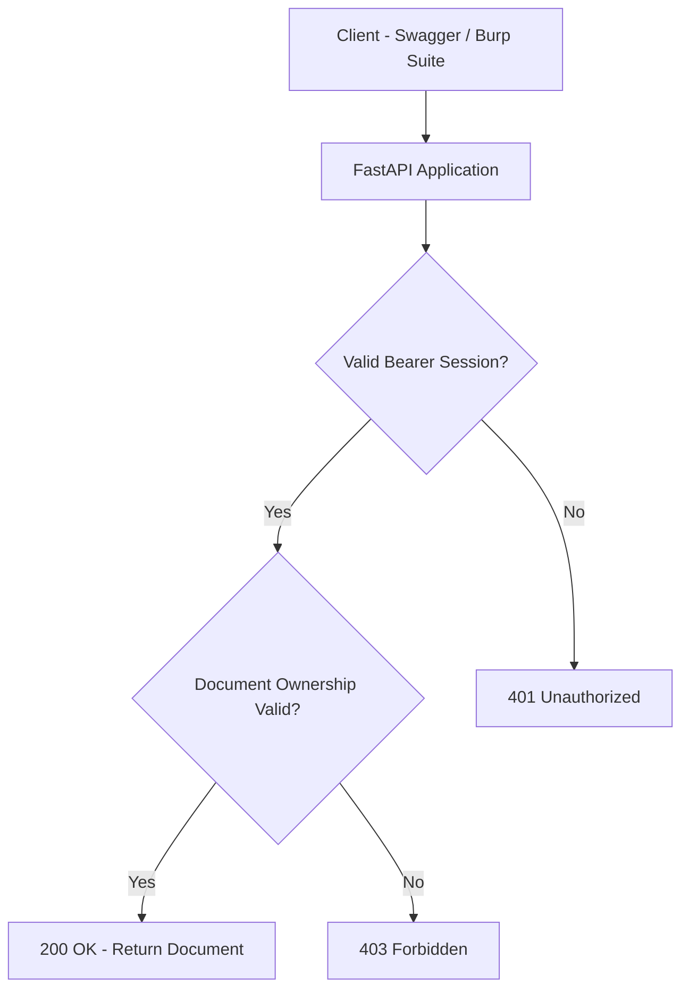
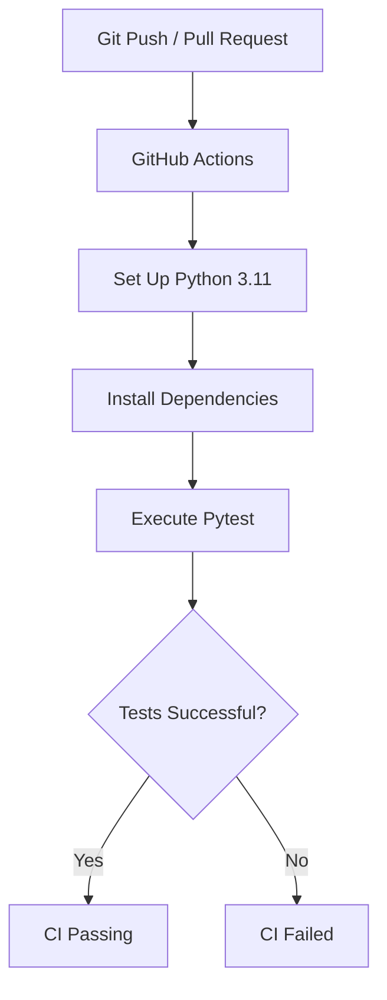

# IDOR Security Lab

[](https://github.com/bymelwine/idor-security-lab/actions/workflows/security-tests.yml)

A hands-on cybersecurity project demonstrating how Insecure Direct Object Reference (IDOR) vulnerabilities occur in REST APIs, how they can be identified, exploited in a controlled environment, and remediated using secure authentication and server-side authorization controls.

Built with **Python, FastAPI, Argon2, and Pytest**.

---

## Project Objectives

- Understand IDOR and Broken Object Level Authorization (BOLA).
- Reproduce unauthorized resource access in a controlled local environment.
- Identify insecure object references in REST APIs.
- Implement server-side object-level authorization.
- Introduce secure password hashing using Argon2.
- Implement token-based authentication and session expiration.
- Prevent identity spoofing through untrusted HTTP headers.
- Automate security regression tests using Pytest.
- Integrate continuous security testing with GitHub Actions.

## Technologies

| Technology | Purpose |
|------------|---------|
| Python 3.11 | Application development |
| FastAPI | REST API framework |
| Uvicorn | Local ASGI server |
| Pytest | Automated security testing |
| HTTPX | HTTP client for API tests |
| pwdlib / Argon2 | Password hashing |
| Burp Suite Community Edition | HTTP request analysis |
| GitHub Actions | Continuous integration |
| Git | Version control |

---

## Vulnerability Demonstration

### Scenario

The initial application contained two fictional users:

| User | Document ID | Owner |
|------|-------------|-------|
| Alice | 101 | Alice |
| Bob | 202 | Bob |

Each document was intended to be accessible only to its owner.

### Vulnerable Implementation

The original endpoint retrieved documents without validating ownership.

```python
@app.get("/documents/{document_id}")
def get_document(document_id: int):
    document = documents.get(document_id)

    if document is None:
        raise HTTPException(status_code=404)

    return document
```

The server retrieved the requested document without checking whether the requester was authorized to access it.

### IDOR Exploitation

In the initial laboratory implementation, identity was simulated using an HTTP header.

Example request:

```http
GET /documents/202 HTTP/1.1
Host: 127.0.0.1:8000
X-Demo-User: alice
```

The server returned:

```json
{
  "requested_by": "alice",
  "document": {
    "owner": "bob",
    "title": "Bob Private Document",
    "content": "Confidential notes belonging to Bob"
  }
}
```

**Result: HTTP 200 OK**

Alice was able to retrieve Bob's private document.

This demonstrated missing object-level authorization.

The original `X-Demo-User` header was also untrusted because clients could freely modify it.

### Root Cause

The application performed a database lookup using a user-controlled document identifier without enforcing object-level authorization.

**Security principle:** Authentication alone does not grant access to every resource.

---

## Security Architecture

The improved application verifies authentication before checking authorization to access a document.



### Request Processing

1. The client sends an HTTP request with a Bearer token.
2. FastAPI validates the session token.
3. The server checks whether the session has expired.
4. The application identifies the authenticated user.
5. The server retrieves the requested document.
6. Object-level authorization verifies document ownership.
7. Access is granted or denied.

The client cannot gain document access merely by changing a document identifier.

---

## Security Remediation

### 1. Password Hashing

The application uses Argon2 through `pwdlib` to hash and verify passwords.

```python
from pwdlib import PasswordHash

password_hash = PasswordHash.recommended()

hashed_password = password_hash.hash("DemoPassword123!")

is_valid = password_hash.verify(
    "DemoPassword123!",
    hashed_password
)
```

Passwords are verified against their hashes rather than compared directly with stored plaintext passwords.

### 2. Token-Based Authentication

Successful authentication generates a random session token.

```python
import secrets

token = secrets.token_urlsafe(32)
```

The token is associated with the authenticated user in server-side memory.

Protected requests use:

```http
Authorization: Bearer <access_token>
```

The application uses opaque session tokens, not JWTs.

### 3. Session Expiration

Sessions have a lifetime of 30 minutes.

```python
SESSION_DURATION = 1800
```

Expired tokens are rejected, and the associated session is removed from memory when checked.

### 4. Object-Level Authorization

The secured endpoint verifies document ownership before returning sensitive data.

```python
if document["owner"] != current_user:
    raise HTTPException(
        status_code=403,
        detail="Access denied"
    )
```

Unauthorized requests receive:

```http
HTTP/1.1 403 Forbidden
Content-Type: application/json
```

```json
{
  "detail": "Access denied"
}
```

### 5. Identity Spoofing Prevention

The secured application no longer trusts the `X-Demo-User` header as proof of identity.

Instead, the server determines the authenticated identity using a valid Bearer session.

Adding an arbitrary identity header does not override the authenticated user.

---

## Installation

### 1. Clone the Repository

```powershell
git clone https://github.com/bymelwine/idor-security-lab.git

cd idor-security-lab
```

### 2. Create a Virtual Environment

On Windows PowerShell:

```powershell
py -m venv .venv

.\.venv\Scripts\Activate.ps1
```

### 3. Install Dependencies

```powershell
python -m pip install -r requirements.txt
```

---

## Running the API

Start the local FastAPI server:

```powershell
uvicorn main:app --host 127.0.0.1 --port 8000
```

Open the interactive API documentation:

http://127.0.0.1:8000/docs

The application runs locally and should not be exposed to the public Internet.

### Available Endpoints

| Method | Endpoint | Description |
|--------|----------|-------------|
| GET | `/` | API health message |
| POST | `/login` | User authentication |
| GET | `/documents/{document_id}` | Protected document retrieval |

### Demo Accounts

The application contains two fictional accounts intended exclusively for local testing.

| Username | Password |
|----------|----------|
| alice | AliceDemo2026! |
| bob | BobDemo2026! |

These credentials are public demonstration values and must never be used for real accounts.

### Example Login

```http
POST /login HTTP/1.1
Host: 127.0.0.1:8000
Content-Type: application/json
```

```json
{
  "username": "alice",
  "password": "AliceDemo2026!"
}
```

A successful response contains a generated Bearer access token.

Use that token with the Swagger **Authorize** feature to test protected endpoints.

Never publish active session tokens in screenshots or documentation.

---

## Automated Security Testing

Security tests are implemented using **Pytest** and FastAPI's `TestClient`.

### Run Tests Locally

```powershell
python -m pytest -v
```

### Test Coverage

| Test | Expected Result |
|------|-----------------|
| Alice accesses her document | 200 OK |
| Alice accesses Bob's document | 403 Forbidden |
| Unauthenticated access | 401 Unauthorized |
| Bob accesses his document | 200 OK |
| Identity spoofing via HTTP header | 403 Forbidden |
| Invalid session token | 401 Unauthorized |
| Incorrect password | 401 Unauthorized |
| Expired session token | 401 Unauthorized |

**Latest verified local result: 8/8 tests passed.**

### Security Regression Testing

These automated tests help detect changes that could reintroduce previously identified authentication or authorization issues.

They verify several important security scenarios but do not constitute a complete application security audit.

---

## Continuous Integration

This repository uses **GitHub Actions** to execute automated security tests.

The workflow is defined in:

`.github/workflows/security-tests.yml`

### CI Pipeline



The pipeline automatically:

1. Checks out the repository.
2. Configures the Python environment.
3. Installs project dependencies.
4. Executes the automated security tests.
5. Reports the final workflow status.

### Workflow Status

[View GitHub Actions](https://github.com/bymelwine/idor-security-lab/actions)

The badge at the top of this README displays the latest CI status for the main branch.

---

## Security Limitations

This project is an educational demonstration, not a production-ready authentication system.

Current limitations include:

- Fictional users and demo passwords are defined in source code.
- Password hashes are regenerated on application startup.
- Sessions are stored in process memory.
- Sessions are lost when the application restarts.
- Session expiration uses a simplified implementation.
- Persistent session storage is not implemented.
- Login rate limiting is not implemented.
- Account registration and password recovery are not implemented.
- Full security monitoring and audit logging are not implemented.
- HTTPS is not configured for the local development server.
- The current authorization model supports simple document ownership.

For production use, additional measures would be required, including persistent identity management, centralized authorization policies, secure secret management, rate limiting, monitoring, and comprehensive security testing.

---

## Key Lessons

### Authentication vs. Authorization

Authentication establishes the identity of a user.

Authorization determines which resources and operations that user is permitted to access.

A valid authentication session does not automatically grant permission to access every resource.

### IDOR / BOLA Prevention

Secure APIs should:

- Enforce authorization checks on the server.
- Validate access to every protected object.
- Apply the principle of least privilege.
- Reject unauthorized resource access.
- Never rely on unpredictable identifiers as the only security mechanism.
- Never trust client-controlled identity headers.
- Test both authorized and unauthorized access scenarios.
- Automate security regression testing.

### Defense in Depth

Effective application security combines:

1. Secure authentication.
2. Session management.
3. Object-level authorization.
4. Input validation.
5. Automated security testing.
6. Continuous integration.
7. Monitoring and secure configuration.

---

## References

- [OWASP API Security Top 10](https://owasp.org/API-Security/)
- [OWASP Web Security Testing Guide](https://owasp.org/www-project-web-security-testing-guide/)
- [PortSwigger Web Security Academy](https://portswigger.net/web-security)
- [FastAPI Documentation](https://fastapi.tiangolo.com/)
- [Pytest Documentation](https://docs.pytest.org/)

---

## Disclaimer

This project is intended exclusively for cybersecurity education, defensive research, and authorized security testing.

All users, documents, and application data are fictional.

The intentionally vulnerable behavior was reproduced only in a controlled local environment.

The published implementation demonstrates selected security remediations and should not be deployed as a production service.
